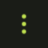
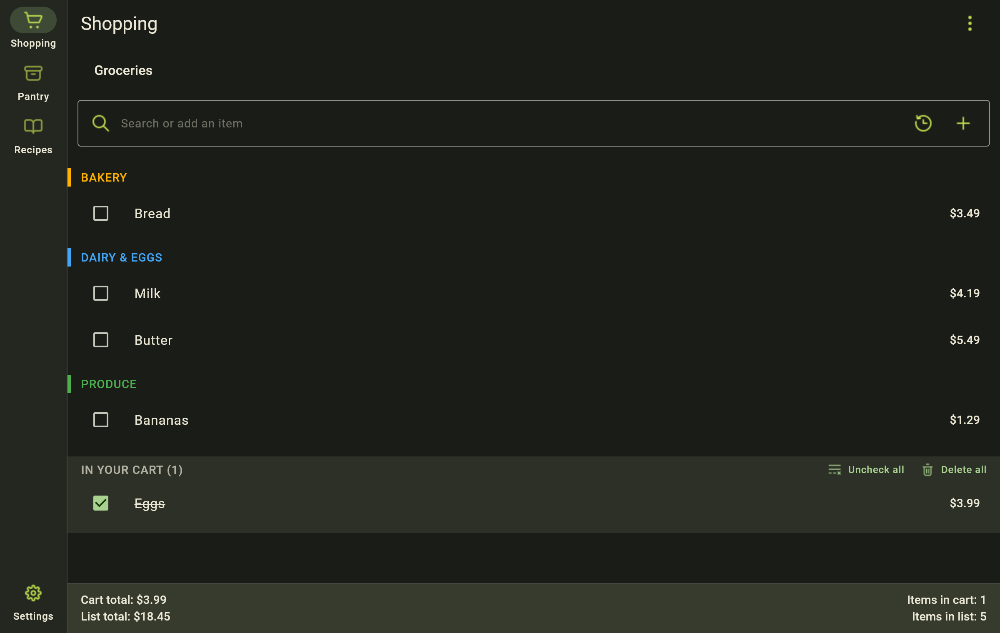
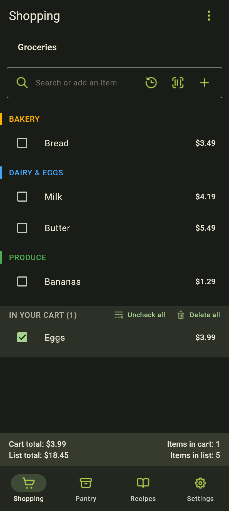
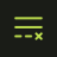
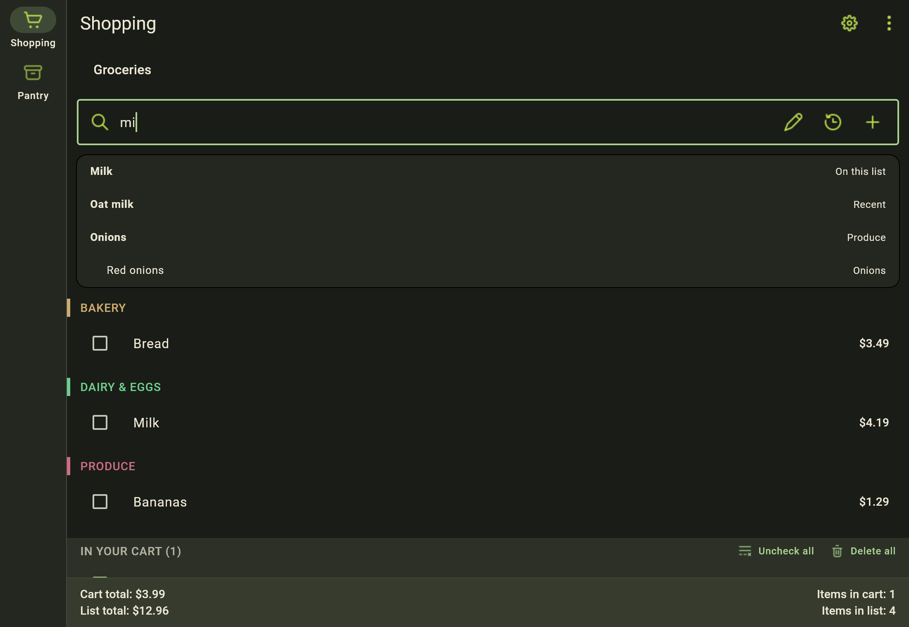
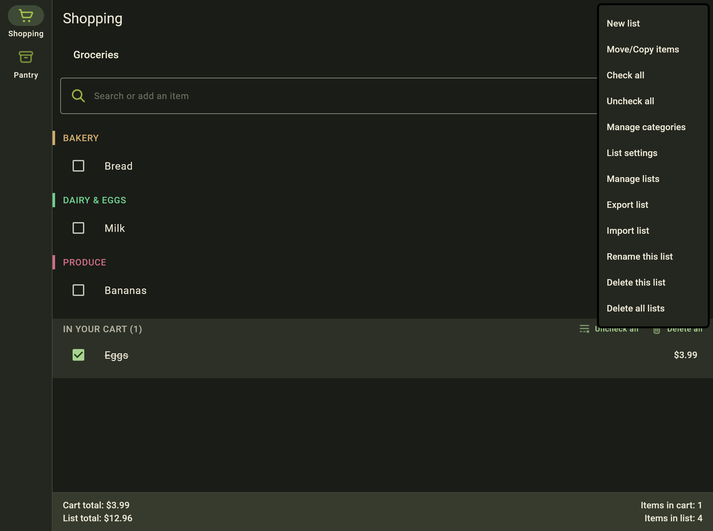
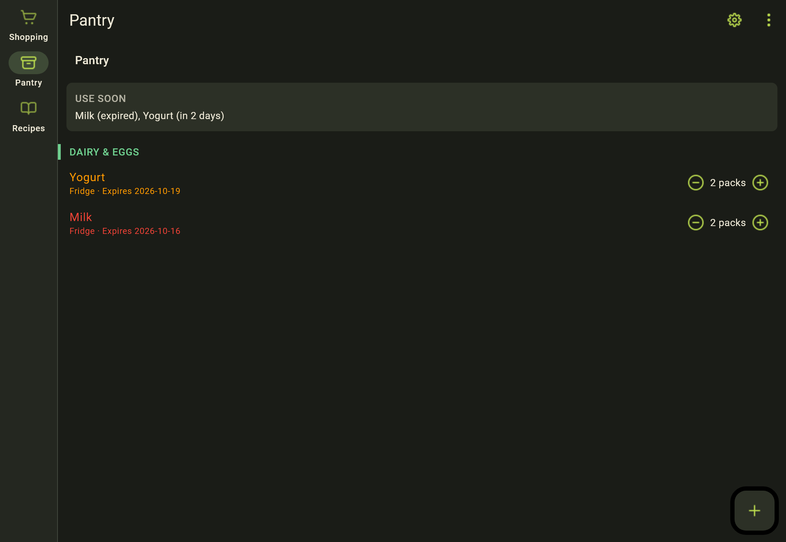

# Using ShopIt

The app is named **ShopIt** on the window title, under the icon, in the Mac menu bar, in Windows Installed apps, and on the download files.

ShopIt is an open source app. It runs the same way on Windows, Mac, Android, and iOS. Use  **Shopping** for what you need to buy,  **Pantry** for what you already have, and  **Recipes** for meals you plan to cook. When the shortest side is under 600, all four sit in the bottom bar and  **Settings** is a full page. An Android phone or an iPhone stays in portrait. A larger window uses the side rail. Settings is a dialog when that window is at least 700 pixels wide, and a full page when it is narrower. Changing the size switches Settings while it is open. On Windows, **Ctrl+,** opens Settings; on Mac, **Command+,** does. Close the page with the X at the top right or with Done.

The list menu is .

## On each platform

Windows and Mac use the side rail. An Android phone and an iPhone use the bottom bar and stay in portrait. An Android tablet and an iPad use the side rail and can turn. The barcode button is on the phones and tablets.

## Controls

<table>
<thead>
<tr>
<th align="left" style="background-color: #2d333b; color: #ffffff;">Icon</th>
<th align="left" style="background-color: #2d333b; color: #ffffff;">Icon use</th>
</tr>
</thead>
<tbody>
<tr>
<td></td>
<td><strong>Shopping</strong> switches to the lists of things to buy.</td>
</tr>
<tr>
<td></td>
<td><strong>Pantry</strong> switches to what you already have.</td>
</tr>
<tr>
<td></td>
<td><strong>Recipes</strong> opens meals you have saved.</td>
</tr>
<tr>
<td></td>
<td><strong>Settings</strong> opens appearance, sales tax, lists, swipe, sharing, and About. <strong>Shopping and pantry</strong>, under Lists, is off until you turn it on. On Windows, <strong>Ctrl+,</strong> opens Settings. On Mac, <strong>Command+,</strong> does. On a phone it is a full page. On a larger window it is a dialog at 700 pixels wide or more, and a full page below that. Changing the size switches it while it is open. The X at the top right and <strong>Done</strong> both leave that page.</td>
</tr>
<tr>
<td></td>
<td><strong>List options</strong> opens the menu for the list you are looking at.</td>
</tr>
<tr>
<td></td>
<td><strong>Add</strong> puts the name in the search field onto the list. A name ShopIt does not already know is saved, so search can find it later.</td>
</tr>
<tr>
<td></td>
<td><strong>Scan</strong> reads a barcode and adds that product. It is on Android and iOS, including tablets. Windows and Mac do not show this button.</td>
</tr>
<tr>
<td></td>
<td><strong>Edit details</strong> sets quantity, unit, category, price, tax, and a note before the item is added.</td>
</tr>
<tr>
<td></td>
<td><strong>History</strong> opens names you have added to a shopping list before. The trash can removes one of those recents. <strong>Clear all history</strong> in the list menu removes every recent at once. Lists are not affected. The saved name stays in search.</td>
</tr>
<tr>
<td></td>
<td><strong>New list</strong> starts another shopping or pantry list.</td>
</tr>
<tr>
<td></td>
<td><strong>Uncheck all</strong> moves everything out of the cart and back onto the list.</td>
</tr>
<tr>
<td></td>
<td><strong>Add to pantry</strong> puts what is in the cart into the pantry. It shows only when <strong>Shopping and pantry</strong> is on in Settings.</td>
</tr>
<tr>
<td></td>
<td><strong>Delete checked items</strong> removes what is in the cart.</td>
</tr>
<tr>
<td></td>
<td><strong>Delete</strong> removes one item, list, category, or rate.</td>
</tr>
<tr>
<td></td>
<td><strong>Use my location</strong> looks up a sales-tax rate for where you are.</td>
</tr>
<tr>
<td></td>
<td><strong>System</strong> follows the device theme.</td>
</tr>
<tr>
<td></td>
<td><strong>Light</strong> uses the light theme.</td>
</tr>
<tr>
<td></td>
<td><strong>Dark</strong> uses the dark theme.</td>
</tr>
</tbody>
</table>

## Shopping

1. Open  **Shopping**.
2. Create a list from the empty screen, or choose **New list** from .
3. If you have more than one list, use the name at the top to switch between them.
4. Type in **Search or add an item**, then press Enter or tap . Use  to set quantity, unit, category, price, tax, and a note before you add. On a phone or tablet, tap  to add from a barcode instead of typing.
5. Tap an item to edit it. Check an item to move it into the cart. Swipe left or right to check or delete, depending on **Swipe** in Settings. When categories are on, drag an unchecked item onto another category that already has items to file it there. Sideways swipe still works on that same row.

From the cart you can uncheck everything () or delete the checked items (). When **Shopping and pantry** is on in Settings,  **Add to pantry** is there too. One pantry list is used. More than one asks which list. A new name is added. A name already there is marked Full, or its exact amount increases by what you bought. Undo puts that change back.

When the list has items, a bar at the bottom shows **Cart total**, **List total**, tax when a rate is set, **Items in cart**, and **Items in list**.

The list menu covers a new list, move/copy, check and uncheck, categories, list settings, manage lists, clear all history, CSV import and export, rename, delete this list, and delete all lists. **Clear all history** sits directly under **Manage lists**. It asks you to confirm, then empties Recent and History. Your lists are not affected. **Manage lists** lets you rename, reorder (drag by the handle), add, or delete shopping lists. **Rename this list** sits directly above **Delete this list**. **Delete all lists** is last; it asks you to confirm, then removes every shopping list and its items. The pantry is not affected. Delete still asks you to confirm.

### Search

The field at the top looks through more than the catalog.

- **On this list** — the name is already on the open shopping list. Choosing it does not add a second copy. ShopIt shows that it is already there and moves the list to that item.
- **In pantry** — you already have it in the pantry. Choosing it does not add it to the shopping list.
- **Recent** — a name from History. Choosing it adds the item again, even if that name is already on this list.  still opens the full history. The trash can beside a name there removes that recent only. **Clear all history** in the list menu removes every recent at once. Lists are not affected. The name stays searchable, and the item stays on any list that already has it.
- Catalog matches come after those. Press Enter or tap  to add something that is not already on the list or in the pantry.

With the field focused and empty, ShopIt shows up to six recent names so repeat groceries are one tap away. On Windows and Mac, the Up and Down arrow keys move through the suggestions, including those empty-field recents.

A name that is not already in ShopIt is saved when you add it to a shopping list or to the pantry. The next search offers it with the built-in items. Adding that same name again does not store a second copy. A new name is filed under **Other**. To pick the category first, tap , choose the category, then add. That category is what the name uses from then on. A pantry name is saved for search, and it does not appear under Recent. Recent is names you have added to a shopping list.

On a phone or tablet,  sits next to Add. A known code adds that name. An unknown code looks up the package, then adds it. If there is no match, you name it; the code is kept so the next scan finds it. Windows and Mac have no scan button. A name added from a scan on the phone still appears on the computer through sync.

### Editing an item

Tap a shopping item to open the editor. On a wide window it is a dialog. On a narrow window it is a bottom sheet. You can change quantity, unit, category, price, tax, notes, and **I have a coupon for this item**. **Move** and **Copy** send the item to another shopping list or to the pantry when those targets exist. Delete removes that item from this list.

### List settings and categories

Categories are alphabetical on every list. A new category slots into that order on its own.

**List settings** controls whether items are grouped by category (**Enable categories**), whether new items are filed automatically (**Auto-categorize items**), and whether empty category headers stay visible (**Show empty categories**). The same screen is where you change tax for the whole list:

- **Use automatic tax rules** — each item follows the rate's rules again.
- **Mark all items taxable**
- **Mark all items not taxable**

Tap a category header to change its color. Manage the full category list from the list menu: add, recolor, or delete. Category order is alphabetical; there is no drag-to-reorder for categories. To move one item into a category that already has items, drag that unchecked row onto the category.

## Pantry

Open  **Pantry** for stock you already have. Add items the same way as on a shopping list, including the  button. An item can be **Low** or **Full**, or an exact amount, and it can include a place and an expiry date. Tap an item to edit quantity, unit, notes, location, and expiry. On a phone or tablet,  adds that product or increases the count if it is already there. Swipe left or right uses the same **Swipe** settings as Shopping; **Check or uncheck** switches Low and Full (or 0 and 1 for an exact amount).

The pantry list menu covers create new list, move/copy, amounts, manage categories, manage lists, CSV import and export, and delete this list. **Manage lists** renames, reorders, adds, or deletes pantry lists.

**Amounts**, in the list menu, sets every item on that pantry list at once. **Low or stocked** uses the Low and Full states. **Exact amounts** uses a number, such as 3 cans. **Apply to all** saves that choice for the items already there and for items you add later. One item can still be changed on its own.

**Use soon** appears at the top when something expires within the next seven days, or is already past its date. Each name says **today**, **tomorrow**, **in N days**, or **expired**.

**Shopping and pantry** in Settings is off until you turn it on. With it on, a Low item, an exact amount at zero, or a Use soon item offers **Add to list**. **Use soon** also has **Add to shopping list** for every name in that strip. The name goes on the shopping list you have open. If that name is already on the list, it is left as it is. Undo removes only the names that step added.

**Move/Copy items** still sends items between shopping lists and pantry lists when that one-step handoff is not enough.

## Recipes

Open  **Recipes** to save a meal.

1. Tap the new-recipe button and name it.
2. Set how many it serves.
3. Add ingredients by the same names you would search for in ShopIt, with an amount and unit. Search suggestions work the same way as on a shopping list.
4. **Add to list** asks which shopping list and how many servings to shop for. Amounts scale from the recipe. Names the pantry already covers are skipped; the rest go on the list. A new line's note says which recipe it is for.
5. **Cook** takes those amounts off the pantry. A full/low item is marked low.
6. **Delete** removes the recipe. Shopping and pantry lists are not changed.

Recipes use the same item names as Shopping and Pantry. They are not a second catalog.

## Sales tax

In **Settings** (), under sales tax ():

- Choose **No tax**, or add a saved rate. A rate can include a grocery rate and its own tax rules (what is taxed).
- **Use my location** () looks up a rate for where you are. Nothing is sent until you tap the button.
- **Place lookup service** sets the host used for that place name (default is OpenStreetMap Nominatim).
- **Ziptax API key** saves or removes your own ZipTax key for US lookups.

Open Settings while Shopping is on screen to pick which rate that list uses. New items start taxable. You can turn tax off for one item in the item editor. To change every item on the list, open **List settings** from .

## Swipe

In **Settings**, under **Swipe**, choose what swipe right and swipe left do. A phone and a desktop are set separately:

- **Phone, swipe right**
- **Phone, swipe left**
- **Desktop, swipe right**
- **Desktop, swipe left**

Each one is **Check or uncheck** or **Delete**. On a shopping list, check moves the item into or out of the cart. On a pantry list, check switches Low and Full, or 0 and 1 for an exact amount. Delete removes that item.

## Sync between phone and computer

On both devices, open **Settings → Share lists**.

The summary at the top tells you which channels are on. Under it, each channel has its own line:

- **Wi-Fi: synced just now** (or a longer time), or **Wi-Fi: not synced yet.**
- **Cloud: synced just now**, or **Cloud: not synced yet.**

A failure stays on that channel. A successful Wi-Fi sync does not clear a cloud error, and the other way around. The same errors also show under **Devices** in Settings.

While sharing is on, Shopping and Pantry show one short line under the list name: **Synced just now**, **Waiting to sync**, or that short error. Share lists still holds the code, the QR code, and the Wi-Fi switch.

### Same Wi-Fi

Create a code on one device and type it on the other. The code is the key, so ShopIt does not send it over the network. Creating, joining, or scanning the code turns **Share on this Wi-Fi** on, including on Windows. Keep both apps open on the same network. Lists appear on the other device only after both have that code.

Turn **Share on this Wi-Fi** off when this device should not be found on the local network. That choice stays off the next time the app opens.

The Windows installer allows ShopIt on private networks, so the phone can reach the computer on Wi-Fi.

### Over the internet

Lists keep syncing when the phone is on mobile data. Both apps need an internet connection while they are open. They do not need to be nearby, and they do not need to be online at the exact same moment.

Pair them by hand:

1. On one device, tap **Create cloud code**. That turns **Share on this Wi-Fi** on.
2. On the other, enter that full code and tap **Join with code**. That turns **Share on this Wi-Fi** on there too.

Or use the QR code:

1. On Windows or Mac, tap **Show QR code**. Showing it turns **Share on this Wi-Fi** on.
2. On an iPhone or Android phone, tap **Scan QR code**. The scan joins the internet household and turns **Share on this Wi-Fi** on for the phone.

Both apps need an internet connection while they are open. They do not need to be nearby, and they do not need to be online at the exact same moment. Closing the app, or sending it to the background, publishes one last cloud snapshot.

List contents are encrypted with the secret half of the household code before they are stored. The cloud topic contains only the mailbox id, the part before the dot. The broker can store that encrypted copy. It does not receive the key, item names, prices, or notes. Leave cloud sync while online to delete this device's stored copy.

If you paired on an earlier build, leave the household on both devices and create a new code. Older codes and older cloud messages are ignored. What ShopIt sends is described in [Privacy](privacy.md).

### Lists with the same name

If both devices already have a shopping or pantry list with the same name, sync keeps one list and adds every device's items onto it. A list the other device has never used does not wipe items on this one. Deleting an item, including clearing the cart, removes that item on the other devices. Checking an item moves it to the cart on the other devices. An item that exists only on one device stays until that item itself is deleted. It does not create a second list. History, tax rates, categories, recipes, and saved catalog names travel in the same encrypted copy.

## Appearance and About

In **Settings**, choose  **System**,  **Light**, or  **Dark**. On Windows, **Ctrl+,** opens Settings. On Mac, **Command+,** does.

**About** is the last section in Settings. It shows ShopIt, the version, a link to the source on GitHub, and **Privacy** and **Licenses**. Those open in place. They do not open another app.

## Uninstall

Uninstall removes ShopIt and everything it stored on that device: lists, settings, and data folders.

- **Windows** — use Apps and Features, or open **Uninstall ShopIt** from the Start Menu folder the installer created. The uninstaller asks once, then removes the program folder under Program Files and its AppData folders.
- **Mac** — the release zip includes **Uninstall-ShopIt.command** next to ShopIt.app. Open that script, confirm, and it quits ShopIt if it is running, removes the app from common locations, and deletes Library preferences, support, caches, and related folders.
- **Android** — uninstall ShopIt from the home screen or from Settings → Apps. The system removes the app and its private data. ShopIt does not write lists into cloud backup, so reinstalling starts empty.
- **iPhone / iPad** — delete the app from the home screen. iOS removes the app container with it.

## Releases

Each app update merged to `main` publishes from the version in `pubspec.yaml`: a Windows installer, an Android APK, and a Mac app. The Mac zip includes the uninstall script. The Releases page keeps only the three newest builds. Changes that only touch this guide or the GitHub README do not publish a new build.
